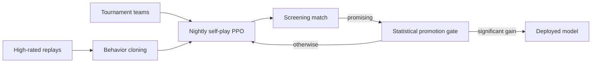

# Pokémon VGC Battle AI

This was an attempt at an AI that plays **Pokémon Champions VGC doubles** (Regulation M-C) on Pokémon Showdown. It combines a neural network with simulator-based lookahead search, learns from high-rated human replays, and keeps improving through nightly self-play.

> This repository documents the project. The source code is not published.

## Overview

| | |
|---|---|
| **Format** | Pokémon Champions VGC 2026, Reg M-C (doubles, bring 4 of 6, best-of-three) |
| **Model** | 4.6M-parameter transformer (PyTorch) with policy and value heads |
| **Search** | Simultaneous-move rollout search in the official Showdown simulator, sampling hidden opponent sets |
| **Training** | Behavior cloning on human replays, then reinforcement-learning self-play (PPO) |
| **Data** | 1,500+ high-rated replays and 3,195 tournament team lists from 54 events |
| **Stack** | JavaScript (Node.js), Python, PyTorch, Git |

## How it works

### Decision making
- **Encoding:** each turn becomes tokens describing the field, both sides' Pokémon, recent events, and every legal joint action for both active slots: moves, targets, switches and Mega Evolution.
- **Policy and value:** a transformer scores every legal action and estimates the win probability.
- **Search:** the bot samples plausible hidden opponent sets from public information and open team sheets. It simulates short continuations in the official battle engine and combines the outcomes using regret-based sampling.

### Learning
- **Behavior cloning:** the bot rebuilds each player's view at every decision from public replays with open team sheets, covering team preview, each turn, and replacements after a faint. A log often can't show the exact choice, for example when a Pokémon flinched or a move was redirected. So training maximizes the probability of all actions consistent with the log rather than guessing one.
- **Self-play:** PPO with human-data mixing keeps exploration anchored to sensible play. Both sides draw from 2,200+ tournament teams so the model meets many strategies.

### Evaluation
- **Promotion gate:** a candidate model replaces the deployed one only if it wins a large paired comparison: 200 pairs on matched seeds and teams, with a one-sided sign test. The significance threshold tightens with every attempt, so repeated tries can't pass by luck.
- **Screening:** a cheaper match first decides whether a candidate deserves a gate attempt.
- **Reproducibility:** each evaluation records hashes of the model, the code, the data and the settings.

### Data pipelines
- **Replays:** a scheduled importer collects new high-rated replays. It deduplicates them, caches them, and stays within the source sites' rate limits.
- **Tournament teams:** another importer catalogs tournament results (placement, record, division and team lists) across Regulations M-A, M-B and M-C.

## Results so far

| Metric | Result |
|---|---|
| Held-out move prediction (top-1, ~100 legal options per turn) | 9.9% → **22.7%** after behavior cloning |
| Latest model with search vs. tactical-planner baseline | 16 matchups better, 11 worse (not yet statistically significant) |
| Search completion after fixes | 72/72 eligible decisions |
| Automated tests | 63 JavaScript + 7 Python |

The neural model has caught up with the hand-built tactical baseline, but it isn't yet proven stronger. Promotion requires a statistically significant win.

## Engineering highlights
- Found and fixed a parsing bug that made open team sheets always come through empty in live play.
- Fixed a state-serialization bug that crashed search rollouts involving Encore.
- Split training and evaluation data by battle and BO3 set, to avoid leaking information between them.
- Profiled the training loop and found that tactical analysis, not battle simulation, is the main bottleneck.
